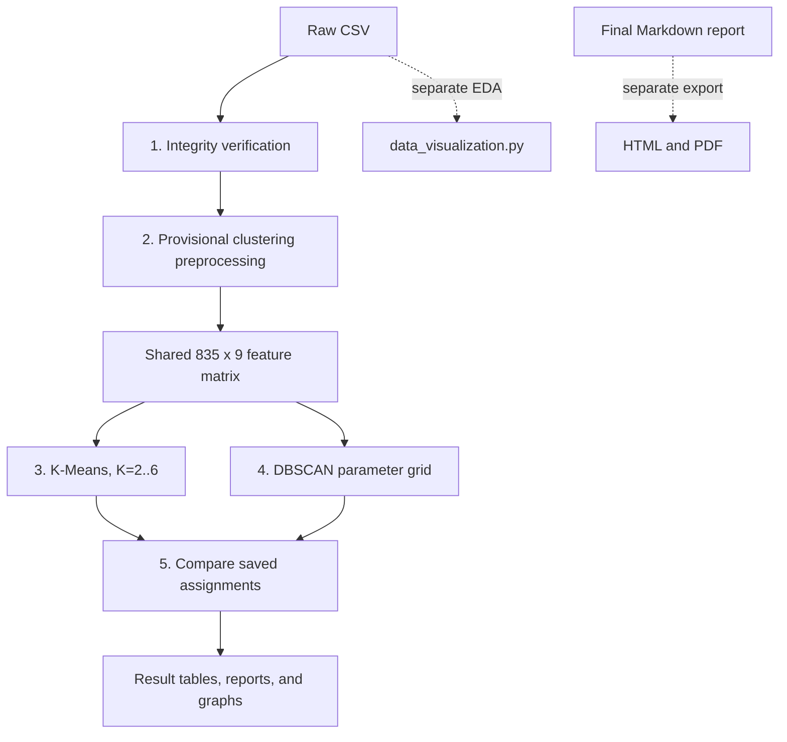
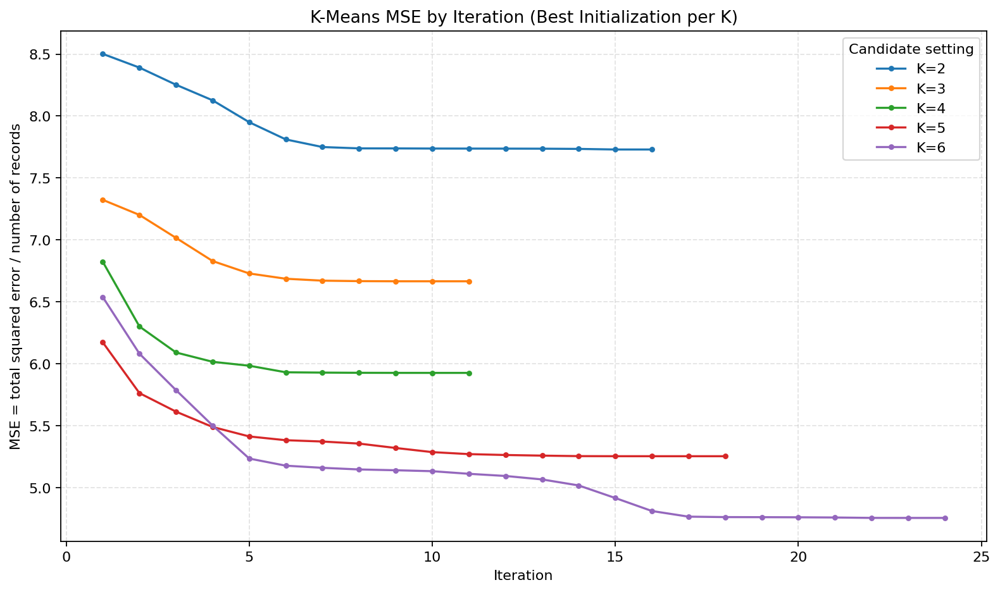
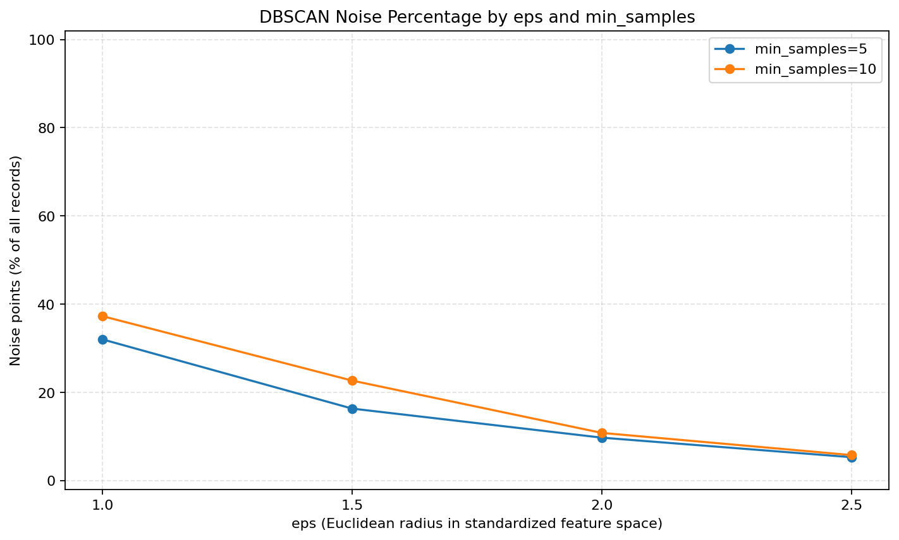
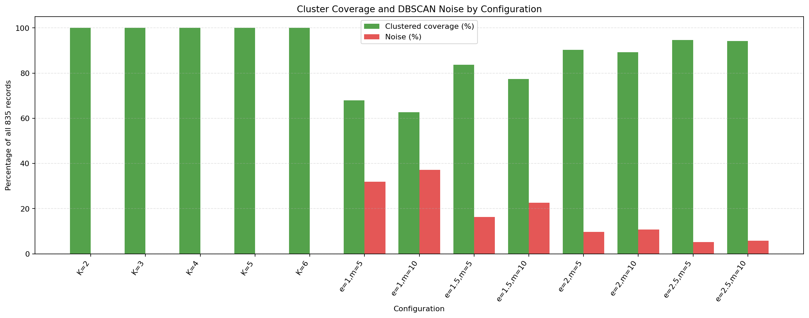
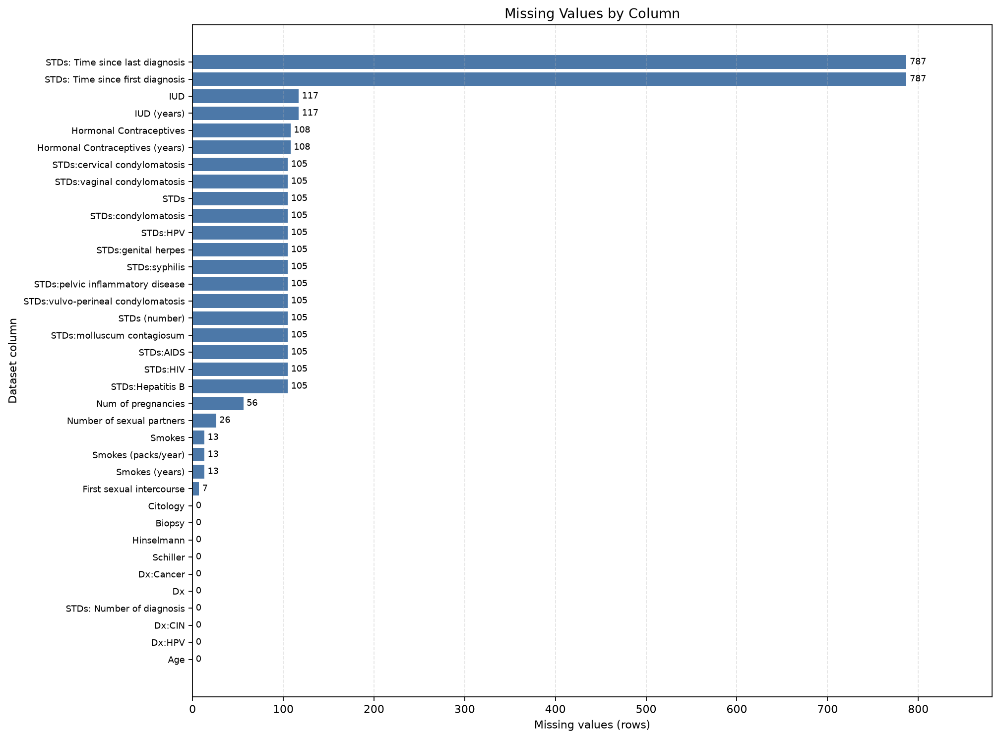

# Cervical Cancer Data Mining Project

## Project introduction

This undergraduate Data Mining project compares **K-Means** and **DBSCAN** on the [UCI Cervical Cancer Risk Factors dataset, dataset 383](https://archive.ics.uci.edu/dataset/383/cervical%2Bcancer%2Brisk%2Bfactors). The exploratory study examines how centroid-based and density-based methods group records when they use the same provisional nine-column feature matrix. K-Means needs a chosen number of clusters and assigns every record; DBSCAN does not require a cluster count and can mark records as noise.

The workflow covers source-data inspection, provisional preprocessing, seven descriptive plots, clustering experiments, internal evaluation, and comparison. It is intended for college Data Mining students and instructors reviewing a practical project. It does not predict health, establish clinical risk, validate a medical grouping, or recommend treatment. Teacher confirmation of the project direction and preparation choices is still pending. The Biopsy-classification proposal remains an unimplemented alternative.

## Table of contents

- [Project introduction](#project-introduction)
- [Objectives](#objectives)
- [Tech stack](#tech-stack)
- [How the project works](#how-the-project-works)
- [Python file guide](#python-file-guide)
- [Folder structure](#folder-structure)
- [CSV files and their columns](#csv-files-and-their-columns)
- [Preprocessing explained](#preprocessing-explained)
- [K-Means and DBSCAN](#k-means-and-dbscan)
- [Results and graphs](#results-and-graphs)
- [Installation and execution](#installation-and-execution)
- [Viva and submission documents](#viva-and-submission-documents)
- [Limitations, reproducibility, and future work](#limitations-reproducibility-and-future-work)

## Objectives

- Inspect the raw dataset and verify dimensions, missing markers, candidate columns, and duplicate counts.
- Create a separate 835 × 9 provisional feature matrix while preserving the raw CSV.
- Run a NumPy Lloyd-style K-Means implementation for K=2–6, with 10 initializations per K and seed 42. Save iteration-level SSE and per-record MSE.
- Run scikit-learn DBSCAN for `eps` = 1.0, 1.5, 2.0, 2.5 and `min_samples` = 5, 10, recording cluster sizes and noise.
- Compare five best-SSE K-Means configurations and all eight DBSCAN configurations on the same standardized matrix.

The current feature list, median imputation, exact duplicate-copy removal, and standardization are configurable **provisional** defaults. DBSCAN silhouette excludes noise and can cover only a subset; it should not be directly ranked against K-Means silhouette, which covers all records. The comparison does not select a universal winner.

## Dataset source and placement

- **Source:** [UCI Machine Learning Repository: Cervical Cancer (Risk Factors)](https://archive.ics.uci.edu/dataset/383/cervical%2Bcancer%2Brisk%2Bfactors)
- **Filename:** `risk_factors_cervical_cancer.csv`
- **Required location:** `data/raw/risk_factors_cervical_cancer.csv`

Copy the UCI dataset file to the path above before running. The workflow interprets literal `?` as missing in memory and writes processed values to a separate file. It never uses the raw CSV as an output target.

## Folder structure

```text
Cervical-Cancer-Data-Mining/
├── data/
│   ├── raw/risk_factors_cervical_cancer.csv
│   └── processed/
│       ├── PROVISIONAL_clustering_features.csv
│       └── PROVISIONAL_data_cleaning_audit.md
├── docs/
│   ├── final_project_report.md
│   ├── project_report_draft.md
│   ├── dataset_inspection.md
│   ├── preprocessing_plan.md
│   ├── preprocessing_options.md
│   ├── clustering_study_plan.md
│   ├── clustering_feature_readiness.md
│   ├── clustering_evaluation_plan.md
│   ├── implementation_checklist.md
│   ├── visualization_notes.md
│   ├── viva_questions.md
│   ├── demo_script.md
│   ├── submission_checklist.md
│   └── presentation_outline.md
├── outputs/
│   ├── graphs/       # 16 exploratory and experiment/comparison PNGs
│   ├── results/      # Reports, CSVs, assignments, audits, run manifest
│   └── submission/
│       ├── Cervical_Cancer_Data_Mining_Report.pdf
│       └── Cervical_Cancer_Data_Mining_Report.html
├── src/
│   ├── inspect_dataset.py
│   ├── data_cleaning.py
│   ├── data_preprocessing.py
│   ├── data_visualization.py
│   ├── clustering_readiness.py
│   ├── verify_data_integrity.py
│   ├── clustering_preprocessing.py
│   ├── kmeans_experiment.py
│   ├── dbscan_experiment.py
│   ├── compare_clustering.py
│   └── render_final_report_pdf.py
├── requirements.txt
├── run_project.py
└── README.md
```

`Practicals/` is a separate workspace directory and is not used or modified by this project workflow.

## Tech stack

CSV, Markdown, HTML, and PDF below are file formats, not programming languages or libraries.

| Technology | Version / requirement | Project use | Files |
|---|---|---|---|
| Python | Current checked shell 3.13.13; runner requires 3.12+ | Runs all scripts | `run_project.py`, `src/*.py` |
| pandas | Current shell and pinned requirement: 3.0.5 | Reads, checks, and writes tabular data | inspect_dataset.py, data_cleaning.py, data_preprocessing.py, data_visualization.py, clustering_readiness.py, verify_data_integrity.py, clustering_preprocessing.py, kmeans_experiment.py, dbscan_experiment.py, compare_clustering.py |
| NumPy | Current shell and pinned requirement: 2.5.2 | K-Means calculations and numeric validation | `kmeans_experiment.py`, `dbscan_experiment.py`, `compare_clustering.py` |
| Matplotlib | Current shell and pinned requirement: 3.11.2 | Creates EDA, experiment, and comparison figures | `data_visualization.py`, `kmeans_experiment.py`, `dbscan_experiment.py`, `compare_clustering.py` |
| scikit-learn | Current shell and pinned requirement: 1.9.0 | DBSCAN and comparison silhouette scores | `dbscan_experiment.py`, `compare_clustering.py` |
| Python standard library | Included with Python | Modules include pathlib, hashlib, subprocess, sys, importlib.metadata, html, tempfile, shutil, and urllib.parse | `run_project.py` and scripts in `src/` |
| CSV | Text data format; no version | Source, processed matrix, assignments, metric tables | `data/`, `outputs/results/` |
| Markdown | Text document format; no version | Plans, audits, guides, experiment and final reports | `README.md`, `docs/`, `outputs/results/` |
| HTML | Generated document format; no version | Styled browser-viewable report with relative image paths | `outputs/submission/Cervical_Cancer_Data_Mining_Report.html` |
| PDF | Generated document format; no version | Printable report, exported with installed Edge or Chrome | `outputs/submission/Cervical_Cancer_Data_Mining_Report.pdf` |

The current shell and `requirements.txt` pins match. There is a version-history difference in saved outputs: `outputs/results/workflow_run_manifest.md` records a prior run with Python 3.14.0, pandas 2.3.3, NumPy 2.4.0, Matplotlib 3.10.8, and scikit-learn 1.8.0; the DBSCAN report also records scikit-learn 1.8.0. Saved results were not rerun to reconcile this. Use the pinned requirements in a new environment and confirm reproduction using fresh outputs.

## How the project works

`run_project.py` coordinates five scripts in dependency order. Each data script resolves paths relative to the project, not the terminal's current directory. The runner uses the active Python interpreter, prints progress, and stops at the first failed script. EDA plotting and report export are separate utilities.



1. Integrity verification reads the raw CSV, interprets ? as missing in memory, checks candidate columns and duplicates, and saves a report.
2. Clustering preprocessing applies configured provisional feature, imputation, duplicate, and scaling choices to a separate copy; validation and an audit are saved with the feature matrix.
3. K-Means reads the matrix, runs five K values with ten seeded starts per K, saves each iteration's metrics, assignments, plots, and report.
4. DBSCAN reads the same matrix and tests eight eps/min_samples settings; assignments, parameter table, plots, and report are saved.
5. Comparison reads the saved assignments, checks row alignment, and computes metrics without refitting either method.
6. The separate EDA script reads the raw CSV and creates seven descriptive plots. It is not run by run_project.py.
7. The separate report renderer converts docs/final_project_report.md to HTML and PDF. It does not run data mining.

## Python file guide

| File | Responsibility and input | Output | Automatic runner |
|---|---|---|---|
| `src/verify_data_integrity.py` | Read-only raw CSV structure, missingness, candidate columns, and duplicate check | `outputs/results/data_integrity_verification.md` | Yes, step 1 |
| `src/clustering_preprocessing.py` | Raw CSV to provisional matrix; validates columns, numeric values, and finite output | `data/processed/PROVISIONAL_clustering_features.csv` and `outputs/results/clustering_preprocessing_audit.md` | Yes, step 2 |
| `src/kmeans_experiment.py` | Direct NumPy Lloyd implementation on the matrix; saves every iteration | Three K-Means CSVs, report, and three PNGs | Yes, step 3 |
| `src/dbscan_experiment.py` | scikit-learn DBSCAN on the same matrix over the parameter grid | Two DBSCAN CSVs, report, and three PNGs | Yes, step 4 |
| `src/compare_clustering.py` | Checks saved assignments and compares them without refitting | Two comparison CSVs, report, and three PNGs | Yes, step 5 |
| `src/data_visualization.py` | Raw CSV descriptive plots; ? is missing in memory | Seven PNGs under `outputs/graphs/` | No; separate |
| `src/inspect_dataset.py` | Reads raw CSV; reports types, missing markers, duplicate rows, outcome counts, and preview | `docs/dataset_inspection.md` | No; separate |
| `src/data_cleaning.py` | Reads raw CSV for a read-only cleaning audit; does not remove or impute rows | `data/processed/PROVISIONAL_data_cleaning_audit.md` | No; separate |
| `src/data_preprocessing.py` | Reads raw CSV for guarded readiness checks for the unimplemented classification alternative | Console only; intentionally exits with code 2 and writes no data | No |
| `src/clustering_readiness.py` | Reads raw CSV and describes candidate feature properties without transforming data | `docs/clustering_feature_readiness.md` | No; separate |
| `src/render_final_report_pdf.py` | Reads final Markdown report and referenced graphs; standard-library export that calls installed Edge or Chrome | `outputs/submission/Cervical_Cancer_Data_Mining_Report.html` and .pdf | No; optional |

`run_project.py` is the orchestrator. It checks the Python minimum and required imports, invokes the five automatic scripts, and writes `outputs/results/workflow_run_manifest.md` after success. It contains no algorithm implementation.

## CSV files and their columns

The raw dataset is the original input; the feature matrix is a derived algorithm input; the remaining CSVs are experimental results. Dimensions and headers below were checked against the actual files.

| CSV file | Dimensions | Meaning of a row and columns |
|---|---:|---|
| `data/raw/risk_factors_cervical_cancer.csv` | 858 x 36 | One dataset record with the supplied demographic, habit, historic, diagnosis, and screening fields; ? is the missing marker. |
| `data/processed/PROVISIONAL_clustering_features.csv` | 835 x 9 | One retained record with nine candidate features after median fill and standardization; shared K-Means/DBSCAN input. |
| `outputs/results/kmeans_run_summary.csv` | 50 x 9 | One initialization: k, initialization, sse_inertia, mse_per_record, iterations, converged, stopping_reason, nonempty_cluster_count, cluster_sizes_in_label_order. |
| `outputs/results/kmeans_iteration_metrics.csv` | 946 x 7 | One Lloyd iteration: k, initialization, iteration, sse_inertia, mse_per_record, max_centroid_shift, nonempty_clusters. |
| `outputs/results/kmeans_cluster_assignments.csv` | 4,175 x 4 | One matrix row for each K's lowest-SSE run: input_row_position, k, best_initialization, cluster_label. |
| `outputs/results/dbscan_parameter_results.csv` | 8 x 11 | One eps/min_samples pair. Headers: eps, min_samples, cluster_count_excluding_noise, noise_count, noise_percentage, non_noise_record_count, cluster_size_distribution, silhouette_score, silhouette_points, silhouette_status, limitation_or_invalid_case. |
| `outputs/results/dbscan_cluster_assignments.csv` | 6,680 x 5 | One matrix row for each of eight settings: input_row_position, eps, min_samples, cluster_label, is_noise; noise label is -1. |
| `outputs/results/clustering_comparison_metrics.csv` | 13 x 19 | One selected configuration. Headers: method, k, best_initialization, eps, min_samples, kmeans_sse_inertia_method_specific, record_count, cluster_count_excluding_noise, cluster_size_distribution, cluster_size_min_max_ratio, cluster_size_normalized_entropy, clustered_record_count, coverage_percentage, noise_count, noise_percentage, silhouette_score, silhouette_records, silhouette_record_count, silhouette_status. |
| `outputs/results/clustering_comparison_cluster_sizes.csv` | 44 x 5 | One formed cluster: method, configuration, cluster_label, cluster_size, is_noise. |

The workflow overwrites generated result files at these paths when rerun; it does not write to the raw CSV path.

## Preprocessing explained

`src/clustering_preprocessing.py` reads the raw file and creates `data/processed/PROVISIONAL_clustering_features.csv` plus an audit. Its configured features are Age, Number of sexual partners, First sexual intercourse, Num of pregnancies, Smokes (years), Smokes (packs/year), Hormonal Contraceptives (years), IUD (years), and STDs (number). Screening outcomes and direct diagnosis/history fields are excluded.

- **Raw preservation:** SHA-256 is checked before and after; derived data goes to a separate path.
- **Missing marker:** ? is treated as missing in memory only. The diagnosis-time columns are excluded; their missing values are not treated as zero or confirmed absence.
- **Duplicates:** 23 extra exact copies are excluded from the modeling copy, leaving 835 rows. This may alter sample distribution, centroids, and DBSCAN density.
- **Imputation:** selected numeric missing values are filled with per-feature medians. This retains rows but inserts synthetic values that change distances.
- **Standardization:** subtracts each feature mean and divides by its population standard deviation. This reduces unit/range dominance but changes the geometry used by both algorithms.
- **Validation:** required columns, all-missing columns, nonnumeric values, empty output, missingness, and finite values are checked.

The 835 x 9 matrix and the feature, median, duplicate, and scaling settings remain provisional and are not teacher-approved. See the [preprocessing audit](outputs/results/clustering_preprocessing_audit.md).

## K-Means and DBSCAN

### K-Means

K-Means starts with K centroids, assigns each record to its nearest centroid, then updates each centroid to the mean of assigned records. These steps repeat until labels stop changing, centroid shift reaches tolerance, or the iteration limit is hit. This project uses direct NumPy Lloyd steps so it can record every iteration. Settings: K=2..6, ten initializations per K, seed 42, max 300 iterations, centroid-shift tolerance 0.0001. The lowest-SSE initialization per K is saved as the representative partition.

For each record, squared error is the sum of squared Euclidean coordinate differences from its assigned centroid. **SSE/inertia** sums those errors over all records. The syllabus-required **MSE per record** is SSE / N with N=835; it is not divided by feature cells. More K generally allows a closer fit and lower inertia, but this alone does not establish a more useful grouping. Silhouette is an internal geometric score and does not validate medical meaning.

### DBSCAN

DBSCAN grows density-connected groups without a predefined cluster count. **eps** is the neighborhood radius; **min_samples** is the neighborhood threshold for a core point. A border point is connected to a core neighborhood without meeting the core threshold itself. A point not connected to a dense group may be marked noise with label -1.

The grid uses Euclidean distance, eps=1.0/1.5/2.0/2.5, and min_samples=5/10. Settings can change cluster count, sizes, and noise. DBSCAN has no random-state parameter; the input order is fixed. Its silhouette excludes noise and is undefined when fewer than two non-noise clusters remain. K-Means silhouette uses every row, so the scores must not be blindly ranked. DBSCAN noise and K-Means assignments differ by design; their objectives do not have a single universally superior result.

## Installation and execution

Open the project folder in VS Code. In PowerShell, navigate to the project root:

~~~powershell
cd "E:\Laxmi\Data Mining\Cervical-Cancer-Data-Mining"
code .
~~~

Then create and activate a virtual environment:

```powershell
py -3.13 -m venv .venv
.\.venv\Scripts\Activate.ps1
python -m pip install -r requirements.txt
```

Select `.venv\Scripts\python.exe` with **Python: Select Interpreter** in VS Code. If PowerShell policy prevents activation, use the environment interpreter directly:

```powershell
.\.venv\Scripts\python.exe run_project.py
```

The current environment has been tested. A new virtual environment and package installation were not run as part of final validation.

To regenerate the submission PDF from Markdown, run `python src/render_final_report_pdf.py` from the project root. This optional export step requires an installed Microsoft Edge or Google Chrome browser; it adds no Python packages and does not run clustering.

## Run the complete workflow

From the project root:

```powershell
python run_project.py
```

From another working directory, call the runner by its absolute path:

```powershell
python "E:\Laxmi\Data Mining\Cervical-Cancer-Data-Mining\run_project.py"
```

The runner resolves scripts relative to itself and executes these steps in order: data integrity verification, clustering preprocessing, K-Means, DBSCAN, comparative evaluation. It uses the active interpreter (`sys.executable`), prints progress and package versions, and stops on the first failed script with its exit code. After success it writes `outputs/results/workflow_run_manifest.md` with the environment, baseline settings, and steps completed. Re-running the workflow regenerates the processed matrix, audits, experiment outputs, figures, and reports at the same paths.

### Run individual steps for debugging

Run commands from the project root; the scripts also resolve their data paths from their own file locations.

```powershell
python src/verify_data_integrity.py
python src/inspect_dataset.py
python src/data_cleaning.py
python src/clustering_readiness.py
python src/data_preprocessing.py
python src/data_visualization.py
python src/clustering_preprocessing.py
python src/kmeans_experiment.py
python src/dbscan_experiment.py
python src/compare_clustering.py
python src/render_final_report_pdf.py
```

The exploratory visualization script is separate from the five-step runner and refreshes seven raw-data figures. Run preprocessing before either clustering experiment if the matrix is absent or needs regeneration. Run both experiments before comparison. The classification readiness check intentionally exits with code 2 while its configuration is unset; it does not create a dataset.

## Viva and submission documents

- [Final Markdown report](docs/final_project_report.md)
- [Submission PDF](outputs/submission/Cervical_Cancer_Data_Mining_Report.pdf)
- [HTML report](outputs/submission/Cervical_Cancer_Data_Mining_Report.html)
- [Viva questions](docs/viva_questions.md)
- [Demo script](docs/demo_script.md)
- [Submission checklist](docs/submission_checklist.md)
- [Presentation outline](docs/presentation_outline.md)

The presentation outline is Markdown; no PPTX or DOCX is present. Processed data and experiment reports are described in the sections above.

## Results and graphs

The raw dataset has 858 rows × 36 columns and 23 exact duplicate copies. The provisional feature matrix excludes those copies, imputes the nine selected numeric candidates with per-feature medians, standardizes them, and contains 835 rows × 9 columns. These preparation choices remain provisional.

### K-Means experiment

The saved experiment has 50 runs (five K values with ten initializations each) and 946 iteration records. The table reports the lowest-SSE initialization for each K.

| K | Best init | SSE/inertia | MSE per record | Silhouette | Iterations | Cluster sizes |
|---:|---:|---:|---:|---:|---:|---|
| 2 | 2 | 6454.529043 | 7.729975 | 0.506262 | 16 | 49, 786 |
| 3 | 2 | 5565.739583 | 6.665556 | 0.231945 | 11 | 300, 495, 40 |
| 4 | 4 | 4947.960819 | 5.925702 | 0.258514 | 11 | 474, 48, 28, 285 |
| 5 | 8 | 4386.017491 | 5.252716 | 0.258375 | 18 | 453, 33, 274, 28, 47 |
| 6 | 8 | 3969.921788 | 4.754397 | 0.260152 | 24 | 47, 430, 90, 32, 28, 208 |

K=2 has the highest tested K-Means silhouette, but its clusters are uneven. The score does not establish K=2 as universally best.



- [K-Means inertia/SSE by K](outputs/graphs/kmeans_inertia_by_k.png)
- [K-Means silhouette by K](outputs/graphs/kmeans_silhouette_by_k.png)

### DBSCAN experiment

All eight eps/min_samples combinations were tested. Silhouette is calculated on non-noise records and is undefined when only one cluster remains.

| eps | min_samples | Clusters | Noise | Noise % | Non-noise cluster sizes | Silhouette |
|---:|---:|---:|---:|---:|---|---:|
| 1.0 | 5 | 3 | 267 | 31.98% | 554, 9, 5 | 0.465577 |
| 1.5 | 5 | 6 | 136 | 16.29% | 658, 8, 14, 9, 5, 5 | 0.096108 |
| 2.0 | 5 | 1 | 81 | 9.70% | 754 | Undefined |
| 2.5 | 5 | 1 | 44 | 5.27% | 791 | Undefined |
| 1.0 | 10 | 1 | 311 | 37.25% | 524 | Undefined |
| 1.5 | 10 | 2 | 189 | 22.63% | 633, 13 | 0.452378 |
| 2.0 | 10 | 1 | 90 | 10.78% | 745 | Undefined |
| 2.5 | 10 | 1 | 48 | 5.75% | 787 | Undefined |

Five settings form one non-noise cluster; noise ranges from 5.27% to 37.25%. The largest valid silhouette is 0.465577 at eps=1.0, min_samples=5, and excludes 267 records (31.98%).



- [DBSCAN cluster counts across settings](outputs/graphs/dbscan_cluster_count_by_parameters.png)
- [DBSCAN valid silhouette values (noise excluded)](outputs/graphs/dbscan_silhouette_by_parameters.png)

### Comparative evaluation

The comparison report covers five selected K-Means partitions and all eight DBSCAN settings. It describes cluster counts and sizes, minimum/maximum size ratio, normalized entropy, coverage, noise, and silhouette with the scored population. K-Means covers all 835 records; DBSCAN may leave noise. K-Means SSE is not ranked against DBSCAN because DBSCAN has no centroid-based SSE objective. No overall winner is selected. The best K-Means silhouette covers all records; the highest DBSCAN silhouette covers only 568 non-noise records.



- [Cluster-size balance comparison](outputs/graphs/clustering_balance_comparison.png)
- [Silhouette versus clustered coverage](outputs/graphs/clustering_silhouette_vs_coverage.png)
- [Detailed comparison report](outputs/results/clustering_comparison_report.md)

### Exploratory visualization

The separate EDA script retains all 858 raw rows and creates seven descriptive plots. It treats ? as missing in memory and omits missing values only where a plot needs observed values. The plots describe distributions and counts; they do not establish cause, medical risk, or diagnosis.



Other EDA plots: [screening-outcome counts](outputs/graphs/screening_outcome_class_counts.png), [age distribution](outputs/graphs/age_distribution.png), [sexual-partner counts](outputs/graphs/sexual_partners_distribution.png), [first-intercourse age](outputs/graphs/first_intercourse_age_distribution.png), [pregnancy counts](outputs/graphs/pregnancies_distribution.png), and [smoking status](outputs/graphs/smoking_status_counts.png).

The 16 current figures are stored under outputs/graphs/: seven EDA plots, three K-Means plots, three DBSCAN plots, and three comparison plots. See the [K-Means report](outputs/results/kmeans_experiment_report.md), [DBSCAN report](outputs/results/dbscan_experiment_report.md), and [comparison report](outputs/results/clustering_comparison_report.md) for complete settings and limitations.

## Limitations, reproducibility, and future work

- The feature list, median imputation, exact-duplicate removal, standardization, K values, and DBSCAN grid are provisional and not teacher-approved.
- Exact duplicates could represent separate observations; removing them changes the sample and can affect DBSCAN density.
- Median imputation inserts synthetic values. Standardization changes distance geometry. Other defensible choices could change the clusters.
- K-Means can depend on initialization; this experiment uses seed 42 and ten starts per K, then reports the lowest-SSE run.
- DBSCAN is sensitive to eps and min_samples. Silhouette excludes noise and can cover only a subset, so it cannot choose a winner alone.
- Clusters are exploratory group identifiers, not diagnoses, clinical risk categories, causal findings, or validated medical groups.
- Teacher confirmation of project direction and preprocessing remains pending. The Biopsy-classification proposal is retained as an unimplemented alternative; it is not part of the runner.
- Syllabus-aligned next work could review choices with the teacher and document further justified K-Means or DBSCAN settings. This comparison does not add out-of-syllabus methods.
