# Comparative Clustering of Cervical Cancer Risk-Factor Records

## Title Page

**Project:** Comparative Study of K-Means and DBSCAN on the UCI Cervical Cancer Risk Factors Dataset  
**Student:** Laxmi Narayan Verma  
**Roll number:** 251235  
**College / institution:** Acharya Narendra Dev College  
**Department:** BSc (Hons.) Computer Science  
**Course:** Data Mining  
**Semester / year:** 3rd semester  
**Teacher / supervisor:** Gunjan Mam  
**Submission date:** 15 October 2026  
**Project repository:** [github.com/its-lnv/data-mining](https://github.com/its-lnv/data-mining)


## Abstract

This project compares two syllabus-listed unsupervised methods, K-Means and DBSCAN, on the UCI Cervical Cancer Risk Factors dataset. The supplied CSV contains 858 records and 36 columns. A provisional feature matrix was prepared from nine numeric candidate columns: exact duplicate copies were excluded, missing candidate values were filled with each feature’s median, and the selected columns were standardized. The resulting matrix contains 835 records and nine features. These preparation choices are configurable and remain provisional.

K-Means was evaluated for K=2 through K=6, with ten seeded initializations per K. Total within-cluster squared error (SSE/inertia) and per-record mean squared error (MSE=SSE/835) were recorded at every iteration. DBSCAN was evaluated for eight pairs formed by `eps` values 1.0, 1.5, 2.0, and 2.5 and `min_samples` values 5 and 10. Comparison used cluster counts and sizes, balance, coverage, noise, and silhouette with its scored population stated. The highest K-Means silhouette among the saved best-SSE runs was 0.506262 at K=2, with cluster sizes 49 and 786. DBSCAN produced one to six clusters and marked 5.27%–37.25% of records as noise. Five DBSCAN settings yielded one non-noise cluster, for which silhouette was undefined. Because DBSCAN silhouette excludes noise and can score a smaller subset than K-Means, these scores do not provide a direct winner ranking. No overall winning method or clinically meaningful cluster is claimed.

## 1. Introduction and Problem Statement

Clustering is an unsupervised data-mining task: the algorithm groups rows using similarities in selected input values, without using a supplied target label to form the groups. This study examines how K-Means and DBSCAN behave on the same feature representation. K-Means requires the analyst to specify K and assigns each record to a cluster. DBSCAN forms groups from dense neighborhoods using `eps` and `min_samples`; records that do not belong to a density-connected group can be labelled noise.

**Problem statement:** Given one provisional, standardized representation of selected dataset attributes, compare the partitions formed by K-Means and DBSCAN across documented parameter settings. Describe cluster sizes, internal separation, balance, coverage, noise, and parameter sensitivity, while respecting the methods’ different objectives and metric coverage.

This is a methodological comparison. Clusters are exploratory groupings under chosen features and distances. They do not establish a diagnosis, causation, medical risk category, or clinical significance.

## 2. Aim, Objectives, and Scope

**Aim:** To compare K-Means and DBSCAN using syllabus-level theory, experiments, internal evaluation, visualizations, and a transparent discussion of limitations.

**Objectives:**

1. Inspect and document the dataset structure, missing markers, duplicates, and screening-outcome counts.
2. Create a separate, auditable provisional feature matrix without changing the source CSV.
3. Run K-Means for K=2–6 with reproducible initializations and save iteration-wise SSE and MSE.
4. Run DBSCAN over a declared `eps` and `min_samples` grid, recording cluster sizes and noise.
5. Compare the saved partitions with silhouette and descriptive size, balance, coverage, and sensitivity measures.
6. Report actual results without medical interpretation or unsupported winner selection.

**Scope:** Only K-Means and DBSCAN are included in the primary experiments. No classifier, diagnosis prediction, oversampling, or association-rule method was implemented. A previous Biopsy-classification proposal is retained in `docs/preprocessing_plan.md` as an alternative plan; it is not the primary implemented workflow.

## 3. Dataset Source and Description

The dataset is **Cervical Cancer (Risk Factors)**, UCI Machine Learning Repository dataset 383. UCI describes 858 instances and 36 features covering demographic information, habits, and historic medical records; its dataset page also notes missing values and provides the dataset citation. The supplied project file is `data/raw/risk_factors_cervical_cancer.csv`. The project uses that local file and does not download data during execution. [UCI dataset record](https://archive.ics.uci.edu/dataset/383/cervical%2Bcancer%2Brisk%2Bfactors)

The columns include age, counts and durations, binary-coded indicators, STD-related history, diagnosis fields, and the four screening outcomes `Hinselmann`, `Schiller`, `Citology`, and `Biopsy`. In the initial inspection, literal `?` markers were interpreted as missing in memory. The report records 23 extra exact duplicate copies. The two diagnosis-time fields each had 787 missing values. No missing diagnosis-time value was interpreted as zero for this clustering feature matrix; those fields are excluded from the nine candidate inputs.

| Dataset item | Recorded value |
|---|---:|
| Raw rows | 858 |
| Raw columns | 36 |
| Extra exact duplicate copies | 23 |
| Repeated full-row groups | 20 |
| `Biopsy` counts in the initial inspection | 803 zero, 55 one |
| Missing in each diagnosis-time field | 787 |
| Provisional clustering matrix | 835 rows × 9 features |

`Biopsy` and the other screening outcomes are described for dataset context only. They were not used to construct, train, or score the clustering partitions.

### 3.1 Provisional feature overview

The current experiments use the nine columns below. Pandas inferred `Age` as integer and the other selected fields as floating-point values after `?` was parsed as missing. Numeric storage does not make discrete counts/durations continuous in meaning or guarantee that all dimensions are appropriate distance features.

| Candidate feature | Inferred raw dtype | Missing before duplicate handling | Provisional median used |
|---|---:|---:|---:|
| Age | int64 | 0 | 26 |
| Number of sexual partners | float64 | 26 | 2 |
| First sexual intercourse | float64 | 7 | 17 |
| Num of pregnancies | float64 | 56 | 2 |
| Smokes (years) | float64 | 13 | 0 |
| Smokes (packs/year) | float64 | 13 | 0 |
| Hormonal Contraceptives (years) | float64 | 108 | 0.5 |
| IUD (years) | float64 | 117 | 0 |
| STDs (number) | float64 | 105 | 0 |

These values and features are recorded from the preprocessing audit. Their use is provisional, not teacher-approved.

## 4. Tools, Libraries, and Environment

- Python 3.13.13
- pandas 3.0.5 for CSV loading, summaries, and result tables
- NumPy 2.5.2 for direct K-Means calculations and numerical validation
- Matplotlib 3.11.2 for figures
- scikit-learn 1.9.0 for DBSCAN and silhouette calculations in DBSCAN/comparative evaluation
- Python standard library for paths, hashes, subprocess execution, JSON formatting, and other utility tasks
- Visual Studio Code for editing and demonstration

The dependency list in `requirements.txt` pins the installed library versions. They require Python 3.12 or newer as documented by the installed package metadata. The workflow was executed in the current environment; a fresh environment was not created for this submission.

## 5. Data Inspection and Exploratory Analysis

The inspection and visualization scripts read the raw file with `?` treated as missing in memory. The raw file is preserved. Seven exploratory figures summarize missing-value counts, screening-outcome counts, age, sexual-partner count, age at first sexual intercourse, pregnancies, and recorded smoking status. They describe the supplied rows; they do not explain why values are missing or establish causes or medical risk.


**Figure 1. Missing values by column.** The very tall bars correspond to the diagnosis-time fields (787 missing values each). Read this as a data-completeness summary only.

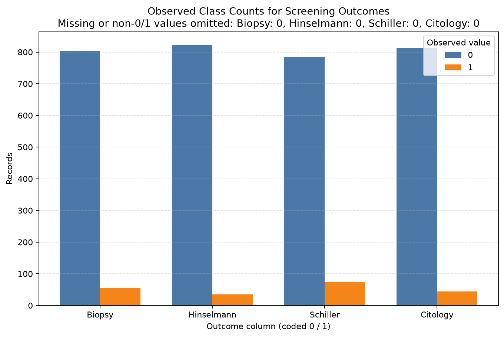

**Figure 2. Screening-outcome counts.** `Biopsy` has 803 zero and 55 one records in the inspected CSV; these counts are not clustering labels or evaluation scores.

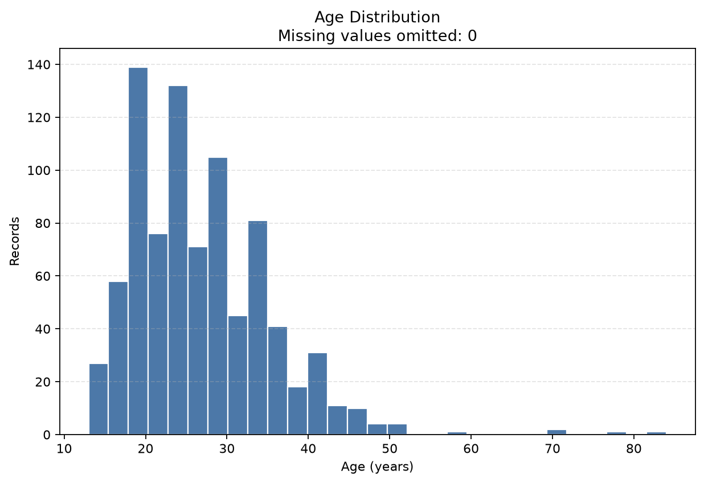

**Figure 3. Age distribution.** Describes the recorded age values in the full raw file; duplicate rows remain present in this exploratory plot.

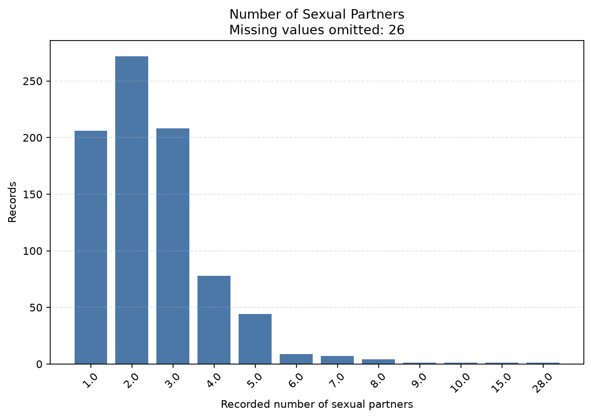

**Figure 4. Number of sexual partners.** Missing entries are omitted from bars and shown in the figure title; the plot does not infer the reason for omission.

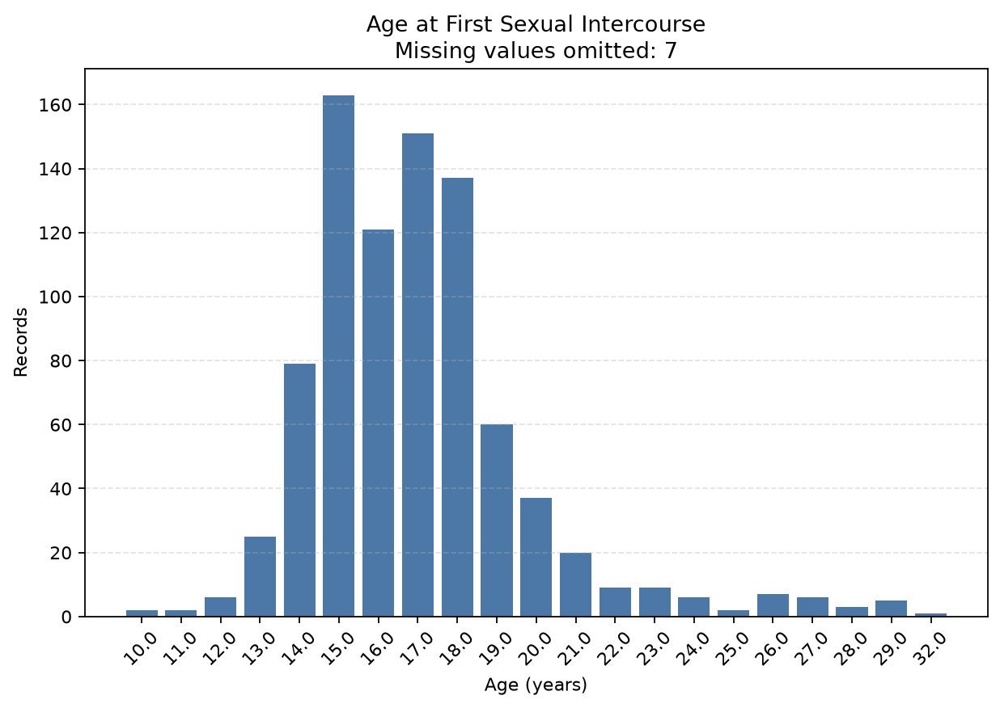

**Figure 5. First-intercourse age.** Missing values are omitted from the plotted count distribution and reported in the figure title.

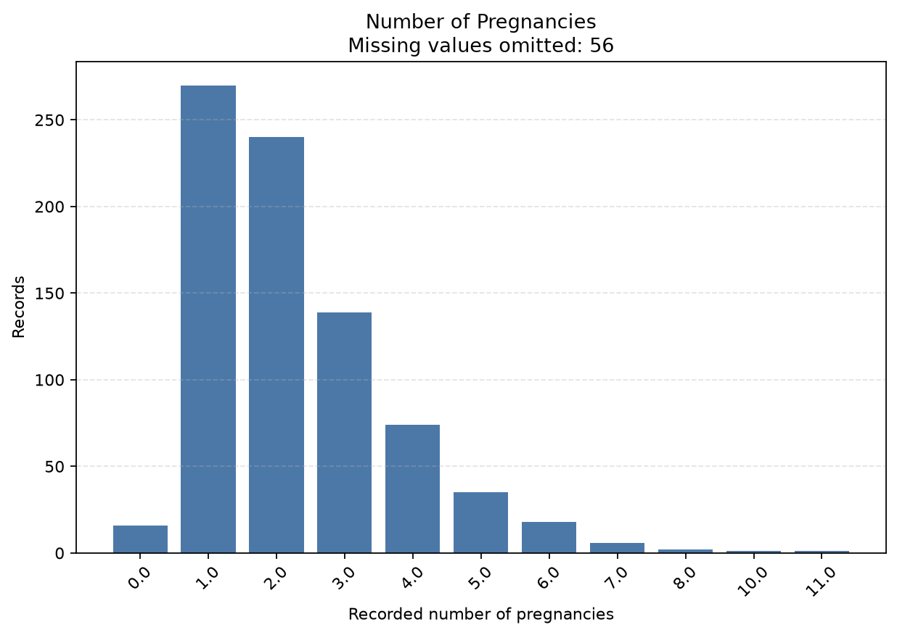

**Figure 6. Number of pregnancies.** Missing values are omitted from bars; values are shown as recorded and are not interpreted as a causal factor.

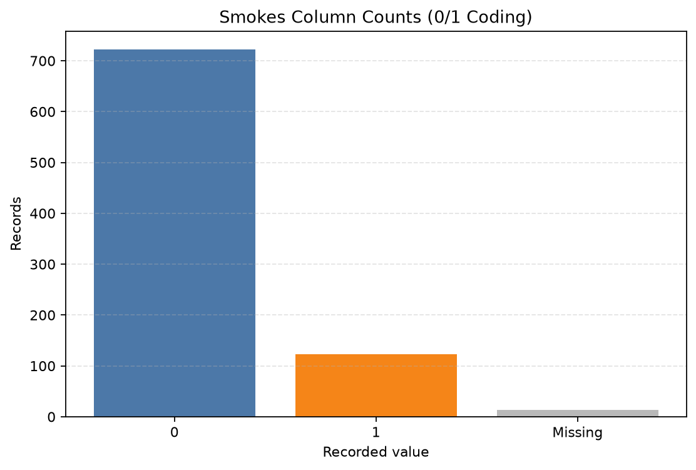

**Figure 7. Recorded smoking-status codes.** The missing category is shown separately. The chart reports codes as recorded and makes no additional inference.

## 6. Missing Values, Duplicate Records, and Preprocessing

The raw inspection found 23 extra rows that exactly match an earlier full row under the parsed representation. Integrity verification defines an extra duplicate using full-row equality after `?` is represented as missing and `duplicated(keep='first')`; it counted 20 repeated-row groups. This equality does not tell whether two rows are accidental copies or distinct records with identical recorded values.

For the first clustering baseline, the script applied these configurable provisional defaults:

| Step | Actual configuration used | Reason and limitation |
|---|---|---|
| Feature selection | Nine columns in Section 3.1; screening and direct diagnosis/outcome fields excluded | Selected as provisional numeric candidates; semantic distance suitability needs review. |
| Missing handling | Per-feature median | Keeps rows and is simple to explain; creates synthetic values and can alter distances. |
| Duplicate policy | Remove exact duplicate copies from the modeling copy; retain first occurrence | Produces 835 rows; whether copies are erroneous remains unresolved, and density/centroids may change. |
| Scaling | Standardization using mean and population standard deviation (`ddof=0`) | Reduces unit/range dominance in Euclidean distances; does not make mixed measurement meanings equivalent. |
| Diagnosis-time fields | Excluded | No missing diagnosis time is treated as zero or as confirmed absence of diagnosis. |

The preprocessing audit reports no missing or non-finite values in the resulting feature matrix. The source CSV is read only. The output is a separate feature-only CSV under `data/processed/`.

## 7. K-Means Methodology

K-Means forms K groups around centroids. The implementation uses Lloyd-style iterations: initialize K centroids from distinct data rows; assign each record to its nearest centroid by squared Euclidean distance; recalculate each non-empty centroid as the mean of its assigned records; then record the squared errors. An empty cluster retains its prior centroid and is recorded with zero members. [scikit-learn K-Means reference](https://scikit-learn.org/stable/modules/generated/sklearn.cluster.KMeans.html)

The project uses a direct NumPy implementation to save each iteration’s metrics. It tests K=2, 3, 4, 5, and 6, with ten initializations per K using seed 42. The lowest-final-SSE initialization is reported for each K. The maximum is 300 iterations; stopping occurs when labels are unchanged from the preceding iteration or the maximum centroid shift is at most 0.0001. The experiment report records input dimensions, settings, iteration histories, and selected run.

### 7.1 SSE/inertia and MSE

For row *i*, squared error is the sum of squared coordinate differences between its feature vector and the centroid assigned to it. **SSE** is the sum of these squared errors over all N records. K-Means calls this within-cluster sum of squares **inertia**. The required plot’s **MSE per record** is:

`MSE = SSE / N`, with N = 835 records.

This is not divided by the number of feature cells. Since N stays fixed across iterations and K settings here, MSE is SSE divided by 835. It is a K-Means optimization measure, not a DBSCAN score. Adding more centroids cannot increase the globally optimal minimum SSE because an existing partition can be retained and a cluster can be split; practical runs may also depend on initialization and converge to local solutions. The observed best-SSE values decrease from K=2 through K=6, but this alone does not justify selecting K=6.


**Figure 8. K-Means MSE by iteration.** Each curve shows the recorded optimization progression for a best-SSE initialization. It does not establish a globally optimal partition or compare K-Means with DBSCAN.

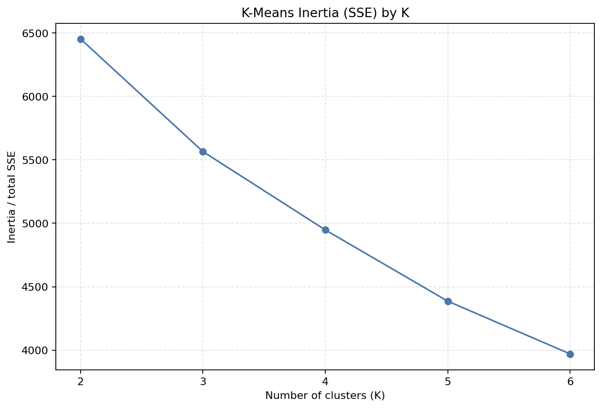

**Figure 9. K-Means SSE/inertia by K.** The decreasing curve is expected as the objective permits additional centroids; use other evidence and cluster sizes when considering K.

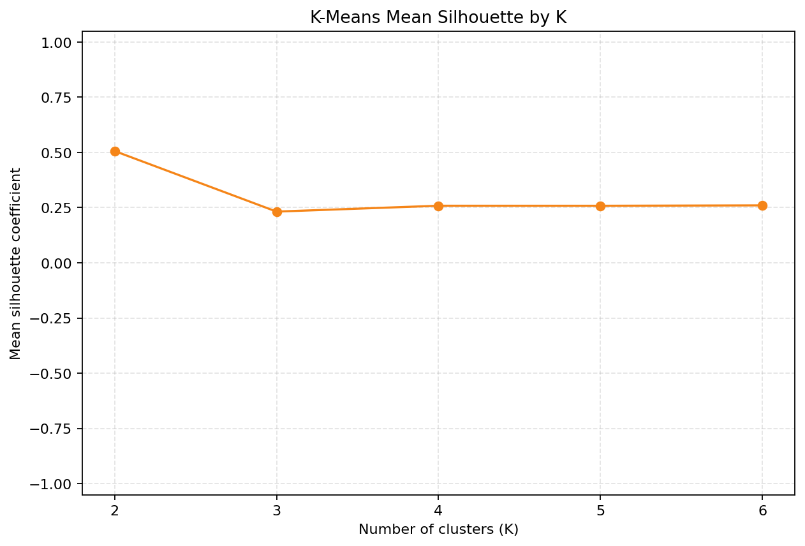

**Figure 10. K-Means silhouette by K.** This internal separation summary is calculated over all 835 records for each K. It is not clinical validation and does not replace examination of cluster sizes.

### 7.2 K-Means results

| K | Best initialization | Final SSE / inertia | MSE per record | Silhouette | Iterations | Cluster sizes |
|---:|---:|---:|---:|---:|---:|---|
| 2 | 2 | 6454.529043 | 7.729975 | 0.506262 | 16 | 49, 786 |
| 3 | 2 | 5565.739583 | 6.665556 | 0.231945 | 11 | 300, 495, 40 |
| 4 | 4 | 4947.960820 | 5.925702 | 0.258514 | 11 | 474, 48, 28, 285 |
| 5 | 8 | 4386.017491 | 5.252716 | 0.258375 | 18 | 453, 33, 274, 28, 47 |
| 6 | 8 | 3969.921788 | 4.754397 | 0.260152 | 24 | 47, 430, 90, 32, 28, 208 |

These values match `outputs/results/kmeans_run_summary.csv` and the experiment report. K=2 has the highest tested silhouette (0.506262), but its partition is strongly uneven (49 versus 786). The result is one observed configuration, not a declaration that K=2 is best for all purposes.

## 8. DBSCAN Methodology and Results

DBSCAN defines an `eps` neighborhood around each point and uses `min_samples` as the minimum neighborhood population for a core point (the point itself is included by scikit-learn). A point with too few neighbors can be a border point if density-reachable from a core point; otherwise it can be noise (`-1`). The number of clusters emerges from density connectivity rather than being supplied in advance. [scikit-learn DBSCAN reference](https://scikit-learn.org/stable/modules/generated/sklearn.cluster.DBSCAN.html)

The saved experiment used Euclidean distance, `algorithm='auto'`, `n_jobs=1`, and the same 835 × 9 standardized matrix as K-Means. The parameter grid was `eps` = 1.0, 1.5, 2.0, 2.5 and `min_samples` = 5, 10. DBSCAN has no `random_state`; row order was fixed and seed 42 is recorded only as the project-level reproducibility setting. These parameter choices remain provisional.

For DBSCAN, cluster-size distributions exclude noise. Noise count and percentage use all 835 input records. The silhouette score is calculated only for non-noise records and only when at least two clusters and a valid label count remain. Thus, its score can represent only a subset of the data. A one-cluster configuration has undefined silhouette rather than an artificial score. The silhouette coefficient ranges from -1 to 1; larger values generally indicate more separation in the specified distance space, but interpretation depends on the representation and included rows. [scikit-learn silhouette reference](https://scikit-learn.org/stable/modules/generated/sklearn.metrics.silhouette_score.html)

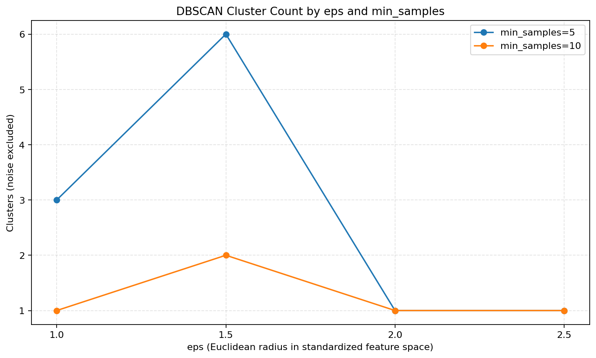

**Figure 11. DBSCAN cluster count by parameters.** Larger `eps` values yielded one cluster for both tested `min_samples` settings; this is a result for the selected standardized representation and parameter grid only.


**Figure 12. DBSCAN noise percentage.** Noise decreased as `eps` increased in this tested grid. The plot should be read with cluster count and size; lower noise does not by itself imply a better partition.

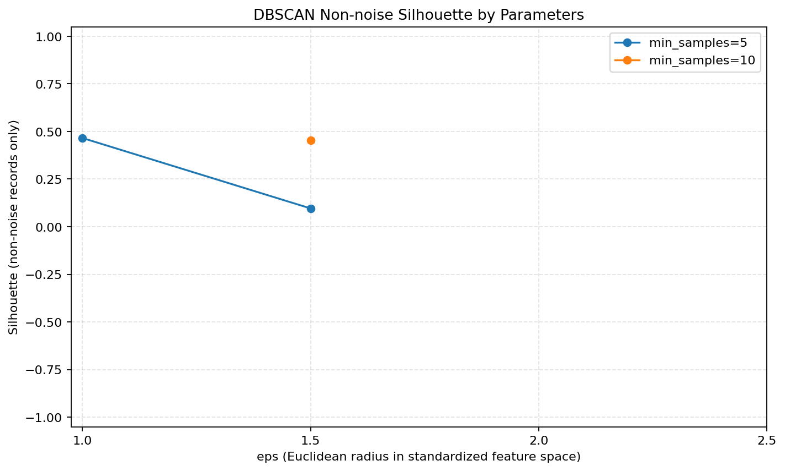

**Figure 13. DBSCAN silhouette on non-noise rows.** Undefined one-cluster cases are not plotted as numeric values. The valid scores describe non-noise subsets, whose sizes vary by setting.

| eps | min_samples | Clusters excluding noise | Noise count | Noise % | Non-noise cluster sizes | Silhouette (noise excluded) | Scored rows |
|---:|---:|---:|---:|---:|---|---:|---:|
| 1.0 | 5 | 3 | 267 | 31.98% | 554, 9, 5 | 0.465577 | 568 |
| 1.5 | 5 | 6 | 136 | 16.29% | 658, 8, 14, 9, 5, 5 | 0.096108 | 699 |
| 2.0 | 5 | 1 | 81 | 9.70% | 754 | Undefined: one cluster | — |
| 2.5 | 5 | 1 | 44 | 5.27% | 791 | Undefined: one cluster | — |
| 1.0 | 10 | 1 | 311 | 37.25% | 524 | Undefined: one cluster | — |
| 1.5 | 10 | 2 | 189 | 22.63% | 633, 13 | 0.452378 | 646 |
| 2.0 | 10 | 1 | 90 | 10.78% | 745 | Undefined: one cluster | — |
| 2.5 | 10 | 1 | 48 | 5.75% | 787 | Undefined: one cluster | — |

These values agree with `outputs/results/dbscan_parameter_results.csv`. Five of eight settings have one non-noise cluster, so silhouette is mathematically undefined. For the three valid settings, scores were 0.465577, 0.096108, and 0.452378. The highest belongs to `eps=1.0, min_samples=5`, but it excludes 267 records (31.98% of the input) as noise. It is not directly comparable to the K-Means score over all records.

## 9. Comparative Evaluation

The comparison script did not refit either algorithm. It re-used saved assignments, validated that each configuration has one label for each of the 835 input positions, recalculated silhouette from those labels, and checked the DBSCAN silhouettes against the stored experiment values.

- **Cluster counts and sizes** show how each setting partitions covered rows. K-Means always assigns every row. DBSCAN cluster counts exclude its noise label.
- **Coverage and noise** report how many records receive a non-noise cluster assignment. K-Means coverage is 100%; DBSCAN noise is shown separately.
- **Minimum/maximum cluster-size ratio** ranges from 0 to 1. **Normalized Shannon entropy** ranges from 0 to 1, with higher values indicating more even sizes for that configuration. DBSCAN size balance excludes noise, so it must be considered alongside DBSCAN coverage.
- **Silhouette** is recomputed with Euclidean distances. K-Means uses all 835 records; DBSCAN uses only non-noise rows and reports its scored population.
- **K-Means SSE/inertia** is deliberately not compared to a DBSCAN quantity. DBSCAN does not minimize a centroid-based within-cluster SSE objective.

| Method | Setting | Clusters | Cluster sizes | Coverage | Noise | Min/max size | Normalized entropy | Silhouette and population |
|---|---|---:|---|---:|---:|---:|---:|---|
| K-Means | K=2, init 2 | 2 | 49, 786 | 100% | 0% | 0.062 | 0.322 | 0.506262, all 835 |
| K-Means | K=3, init 2 | 3 | 300, 495, 40 | 100% | 0% | 0.081 | 0.749 | 0.231945, all 835 |
| K-Means | K=4, init 4 | 4 | 474, 48, 28, 285 | 100% | 0% | 0.059 | 0.697 | 0.258514, all 835 |
| K-Means | K=5, init 8 | 5 | 453, 33, 274, 28, 47 | 100% | 0% | 0.062 | 0.684 | 0.258375, all 835 |
| K-Means | K=6, init 8 | 6 | 47, 430, 90, 32, 28, 208 | 100% | 0% | 0.065 | 0.742 | 0.260152, all 835 |
| DBSCAN | eps=1, min_samples=5 | 3 | 554, 9, 5 | 68.02% | 31.98% | 0.009 | 0.120 | 0.465577, 568 non-noise |
| DBSCAN | eps=1, min_samples=10 | 1 | 524 | 62.75% | 37.25% | 1.000 | 0.000 | Undefined (one cluster) |
| DBSCAN | eps=1.5, min_samples=5 | 6 | 658, 8, 14, 9, 5, 5 | 83.71% | 16.29% | 0.008 | 0.175 | 0.096108, 699 non-noise |
| DBSCAN | eps=1.5, min_samples=10 | 2 | 633, 13 | 77.37% | 22.63% | 0.021 | 0.142 | 0.452378, 646 non-noise |
| DBSCAN | eps=2, min_samples=5 | 1 | 754 | 90.30% | 9.70% | 1.000 | 0.000 | Undefined (one cluster) |
| DBSCAN | eps=2, min_samples=10 | 1 | 745 | 89.22% | 10.78% | 1.000 | 0.000 | Undefined (one cluster) |
| DBSCAN | eps=2.5, min_samples=5 | 1 | 791 | 94.73% | 5.27% | 1.000 | 0.000 | Undefined (one cluster) |
| DBSCAN | eps=2.5, min_samples=10 | 1 | 787 | 94.25% | 5.75% | 1.000 | 0.000 | Undefined (one cluster) |

**Table 4. Comparison of all 13 saved configurations.** DBSCAN cluster balance uses non-noise cluster sizes only. A one-cluster DBSCAN setting has a min/max ratio of 1 by definition; it should not be mistaken for a useful balanced multi-cluster solution.

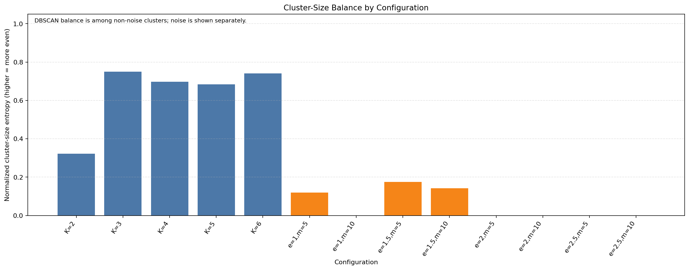

**Figure 14. Cluster-size balance.** The figure uses normalized entropy, where a larger value means more even cluster sizes. DBSCAN’s calculation omits noise, so the noise plot and coverage remain necessary context.


**Figure 15. Coverage and noise.** K-Means covers all 835 records. DBSCAN’s green coverage and red noise percentages sum to 100% for each parameter setting.

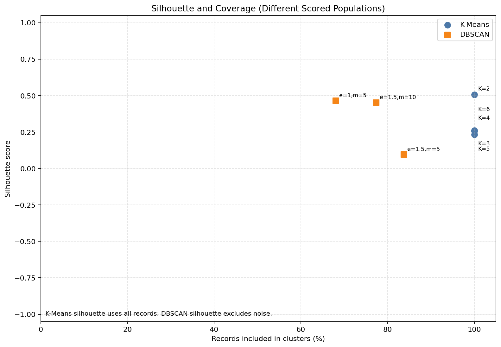

**Figure 16. Silhouette and coverage.** This plot explicitly shows differing scored populations. It is a visual aid, not a direct ranking: DBSCAN scores exclude noise, and DBSCAN settings may form different cluster counts and subset sizes.

The highest K-Means silhouette among these best-SSE initializations is 0.506262 at K=2; the highest valid DBSCAN silhouette is 0.465577 at `eps=1.0, min_samples=5`. The closeness of those values does not establish a winner because DBSCAN’s score excludes noise. Cluster count, tiny cluster sizes, balance, coverage, and parameter sensitivity all change the interpretation. Five DBSCAN settings produce one cluster, while the other three create small clusters in addition to one large cluster. No single internal metric establishes the “best” method.

## 10. Limitations, Reproducibility, and Threats to Validity

1. **Provisional preprocessing:** nine-feature selection, median imputation, duplicate-copy removal, and standardization affect the distance space and may change all assignments. They remain subject to teacher guidance.
2. **Duplicate interpretation:** exact equality is verified, but the CSV does not identify whether repeated rows are accidental. Removing copies changes centroid weights and especially DBSCAN density.
3. **Missing values:** median imputation is not a neutral operation. In particular, the meaning of the two highly incomplete diagnosis-time columns is unresolved; these are excluded rather than interpreted as zero.
4. **Feature semantics:** several numeric values are counts or durations, with skew and many zeros. Standardization changes scale but does not settle whether ordinary Euclidean distance is appropriate for each feature.
5. **Parameter coverage:** only K=2–6, four `eps` values, and two `min_samples` values were tested. A different grid or feature representation could lead to different outcomes.
6. **Initialization/local solutions:** the K-Means report selects the lowest-SSE run among ten starts per K. It is not proof of a global optimum; seed 42 makes the tested procedure repeatable.
7. **Internal metrics:** silhouette describes separation in the selected distance space, not external validity. DBSCAN excludes noise and has undefined silhouette for single-cluster configurations. Balance is descriptive and DBSCAN balance omits noise.
8. **No external labels:** no outcome labels were used to fit or validate clusters. The work therefore cannot support diagnosis, prediction, causality, or clinical claims.
9. **Environment reproducibility:** `requirements.txt` pins the installed versions and `run_project.py` uses the active interpreter. The current environment was tested; a fresh virtual environment was not created.

The preprocessing audit records the random seed setting 42 (preprocessing is otherwise deterministic); K-Means uses seed 42 and ten starts per K; DBSCAN uses fixed row order and has no random-state setting. Reports record the selected grid, convergence rule, library version, and common input dimensions. The raw CSV SHA-256 was verified unchanged as `8DF193AD5C9FF4288FB4C401EEF70DCD2CBDA404CE7F82AC74C68CFC960AB063`. The processed matrix hash before final submission validation was `E978ECEDF0B303364FFA1605C19EC54C9A4011C637C27CD6BFCD6A3E4B01A727`; a clean workflow rerun must reproduce that content for the current configuration.

## 11. Conclusion

On the saved 835 × 9 provisional standardized matrix, K-Means assigned every record for K=2–6. Its best-SSE runs had silhouettes from 0.231945 to 0.506262, with several uneven cluster-size distributions. DBSCAN produced one to six clusters and 5.27%–37.25% noise across the tested grid; five configurations formed one non-noise cluster. The valid DBSCAN silhouettes were computed only among non-noise records. These results demonstrate different assignment and noise behavior and sensitivity to settings, but they do not establish one universally superior clustering method.

The project demonstrates data inspection, preprocessing, visualization, two syllabus-listed algorithms, parameter experiments, internal evaluation, and results analysis. Its conclusion is limited to these recorded experiments. The selected features, imputation method, duplicate policy, scale, and parameter grid remain provisional and should be reviewed with the teacher. Clusters must not be treated as medical diagnoses or validated clinical groups.

## 12. References

1. Fernandes, K., Cardoso, J., & Fernandes, J. (2017). *Cervical Cancer (Risk Factors)* [Dataset]. UCI Machine Learning Repository, dataset 383. [https://doi.org/10.24432/C5Z310](https://doi.org/10.24432/C5Z310). [Dataset record](https://archive.ics.uci.edu/dataset/383/cervical%2Bcancer%2Brisk%2Bfactors).
2. scikit-learn developers. *K-Means clustering reference*. [https://scikit-learn.org/stable/modules/generated/sklearn.cluster.KMeans.html](https://scikit-learn.org/stable/modules/generated/sklearn.cluster.KMeans.html).
3. scikit-learn developers. *DBSCAN clustering reference*. [https://scikit-learn.org/stable/modules/generated/sklearn.cluster.DBSCAN.html](https://scikit-learn.org/stable/modules/generated/sklearn.cluster.DBSCAN.html).
4. scikit-learn developers. *Silhouette score reference*. [https://scikit-learn.org/stable/modules/generated/sklearn.metrics.silhouette_score.html](https://scikit-learn.org/stable/modules/generated/sklearn.metrics.silhouette_score.html).
5. Project primary records: `outputs/results/data_integrity_verification.md`, `outputs/results/clustering_preprocessing_audit.md`, `outputs/results/kmeans_experiment_report.md`, `outputs/results/dbscan_experiment_report.md`, and `outputs/results/clustering_comparison_report.md`.

## Appendix A. Execution Instructions and Artifacts

From a PowerShell terminal, the complete implemented workflow can be run from any current directory using the project’s absolute path:

```powershell
python "E:\Laxmi\Data Mining\Cervical-Cancer-Data-Mining\run_project.py"
```

When the terminal is already at the project root, use `python run_project.py`. The runner invokes integrity verification, preprocessing, K-Means, DBSCAN, and comparison in order. It regenerates its derived matrix, reports, tables, assignments, and clustering figures. It never writes to the raw CSV path. Individual debugging commands are listed in `README.md`.

Main artifacts:

- Processed feature matrix: `data/processed/PROVISIONAL_clustering_features.csv`
- Integrity and preprocessing reports: `outputs/results/data_integrity_verification.md`, `outputs/results/clustering_preprocessing_audit.md`
- K-Means tables/assignments/report: `outputs/results/kmeans_iteration_metrics.csv`, `kmeans_run_summary.csv`, `kmeans_cluster_assignments.csv`, `kmeans_experiment_report.md`
- DBSCAN tables/assignments/report: `outputs/results/dbscan_parameter_results.csv`, `dbscan_cluster_assignments.csv`, `dbscan_experiment_report.md`
- Comparative tables/report: `outputs/results/clustering_comparison_metrics.csv`, `clustering_comparison_cluster_sizes.csv`, `clustering_comparison_report.md`
- Environment/configuration for each complete workflow run: `outputs/results/workflow_run_manifest.md`
- All 16 PNG figures: `outputs/graphs/`
